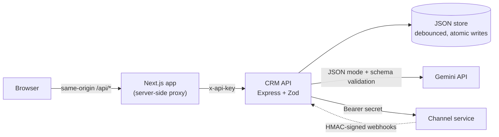
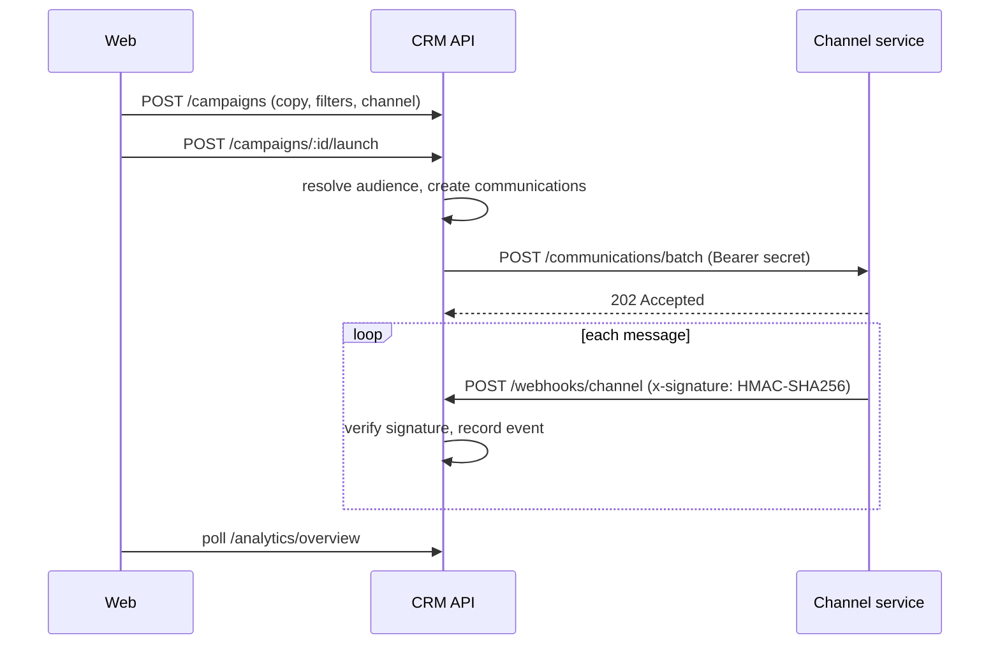

# AI Campaign Copilot

A marketing CRM where you describe an audience in plain English, get AI-written campaign copy and a channel recommendation, launch it, and watch delivery events stream back in real time.

> "Find customers who spent over INR 5000 and have not purchased in 60 days"
> → filters `{ minSpend: 5000, inactiveDays: 60 }` → matching customers → WhatsApp win-back copy → launch → live funnel.

## Features

- **Natural-language segmentation.** Gemini turns a prompt into typed audience filters. A regex parser fills in when no key is set or the model returns something invalid.
- **AI copywriting and channel choice.** The model drafts the title, subject, body and CTA (with `{{name}}` personalization) and picks WhatsApp, SMS, Email or RCS with a confidence score.
- **Asynchronous delivery pipeline.** A separate channel service simulates provider behaviour (delivered, opened, clicked, converted, failed) and reports back through signed webhooks.
- **Live results.** A delivery funnel that counts every stage a message reached, a feed of customer responses, and AI suggestions on what to try next.
- **Installable on phones.** Add it to the Home Screen on iPhone or Android; it opens full screen with its own icon (PWA).
- **Live message preview.** See the message as the customer will on WhatsApp, SMS, Email or RCS, with their name filled in and SMS length counted.

## Design

- **Palette:** Hostinger colour scheme #29 (indigo `#1D1842`, wine `#8E0D3C`, red-orange `#EF3B33`, pink `#FDA1A2`). The red-orange is deepened to `#D7261E` in light mode and brightened to coral `#FF6B5E` in dark mode so text and buttons pass WCAG AA.
- **Apple Human Interface Guidelines:** system typeface and text styles, inset grouped forms, pill buttons, a segmented control for channels, 44 pt touch targets, safe areas, and light and dark appearance.
- **Structure:** the app opens on a dashboard (people reached, open and purchase rates, recent campaigns, latest results, top customers). New campaigns are created in a full-screen four-step wizard (audience, message, channel, review). A floating menu button in the bottom-right corner switches sections.
- **3D:** the landing page hero is a three.js phone (React Three Fiber + drei) whose screen is drawn to a canvas texture; it tilts with the pointer, holds still when reduced motion is on, and falls back to a flat phone without WebGL.
- **Components:** the Hold to send button and the result rings are adapted from [Kokonut UI](https://kokonutui.com) (MIT); animation uses [Motion](https://motion.dev).
- **Pages:** `/` is the landing page and `/app` is the product.

## Architecture



| App | Stack | Responsibility |
| --- | --- | --- |
| `apps/web` | Next.js 16, React 19, Tailwind | Dashboard UI, plus a route handler that proxies `/api/*` to the CRM so no secret or backend URL reaches the browser |
| `apps/crm-api` | Express, Zod, Gemini SDK | Segmentation, campaigns, AI helpers, webhook receiver, data store |
| `apps/channel-service` | Express, Zod | Simulated messaging provider with asynchronous lifecycle callbacks |

### Launch flow



## Security model

- **No secrets in the browser.** The UI calls its own origin, and the Next.js route handler adds `CRM_API_KEY` on the server.
- **API key on the CRM API.** Every route except `/health` and the webhook requires `x-api-key`, compared in constant time.
- **Signed webhooks.** The channel service signs each callback body with HMAC-SHA256 (`CHANNEL_SHARED_SECRET`), and the CRM checks it against the raw request bytes.
- **No arbitrary callbacks (SSRF protection).** The channel service only calls origins listed in `ALLOWED_CALLBACK_ORIGINS`, and batches are capped at 1,000 messages.
- **Model output is untrusted.** Gemini runs in JSON mode, every response is checked against a Zod schema, and user prompts are passed as quoted data.
- **Fail closed in production.** With `NODE_ENV=production`, both services refuse to start without their secrets.
- **Clean errors.** Validation errors return 400, missing records 404, and anything else a generic 500 with no internal details.

## Getting started

Requires Node 22+.

```bash
npm install
cp .env.example .env   # optional: add GEMINI_API_KEY and secrets
npm run dev
```

- Web: http://localhost:3000
- CRM API: http://localhost:4000/api/health
- Channel service: http://localhost:4100/health

The CRM API creates 1,000 customers and 5,000 orders on first boot (`apps/crm-api/data/store.json`). Delete that file to reseed. Without `GEMINI_API_KEY` every AI feature uses deterministic fallbacks, so the whole flow still works offline.

### Environment

All apps read the repo-root `.env`. See [.env.example](.env.example) for the full list.

| Variable | Used by | Purpose |
| --- | --- | --- |
| `GEMINI_API_KEY`, `GEMINI_MODEL` | CRM | Enable Gemini (default model `gemini-2.5-flash`) |
| `CRM_API_KEY` | web, CRM | Authenticates the web proxy to the CRM |
| `CHANNEL_SHARED_SECRET` | CRM, channel | Bearer auth and webhook HMAC |
| `CRM_API_URL` | web | Where the proxy forwards requests |
| `CRM_PUBLIC_URL`, `CHANNEL_SERVICE_URL` | CRM | Service-to-service URLs |
| `ALLOWED_CALLBACK_ORIGINS` | channel | Webhook destinations it may call |
| `DATA_FILE` | CRM | Store location; put it on a persistent disk in production |

## Scripts

| Command | What it does |
| --- | --- |
| `npm run dev` | Run all three apps with hot reload |
| `npm test` | Unit tests (`node:test` through `tsx`) |
| `npm run typecheck` | Strict TypeScript across all workspaces |
| `npm run build` | Production build of every app |

CI runs typecheck, tests and build on every push and pull request.

## Deployment

- `apps/web` can go to Vercel or any Node host. Set `CRM_API_URL` and `CRM_API_KEY`.
- `apps/crm-api` and `apps/channel-service` run as separate Node services (`npm run build && npm start`). Set `NODE_ENV=production` and the secrets.
- Mount a persistent volume for `DATA_FILE`. Most PaaS filesystems are wiped on redeploy.

## Design decisions and trade-offs

- **JSON file store.** Zero setup, easy to inspect, and writes are batched every 250 ms and swapped in atomically. It is single-process and keeps everything in memory, so a real deployment should move to Postgres.
- **AI with deterministic fallbacks.** The product never depends on the model being up, and fallbacks keep demos and tests reproducible.
- **Polling instead of WebSockets.** The dashboard refreshes every 5 seconds. That's simple and good enough at demo scale; server-sent events would be the next step.

## Roadmap

- [ ] Idempotent launches and callback retries with backoff
- [ ] Postgres via Prisma; replace linear scans with indexed queries
- [ ] User accounts and per-workspace data
- [ ] Consent, opt-out and frequency capping
- [ ] End-to-end tests (Playwright)
