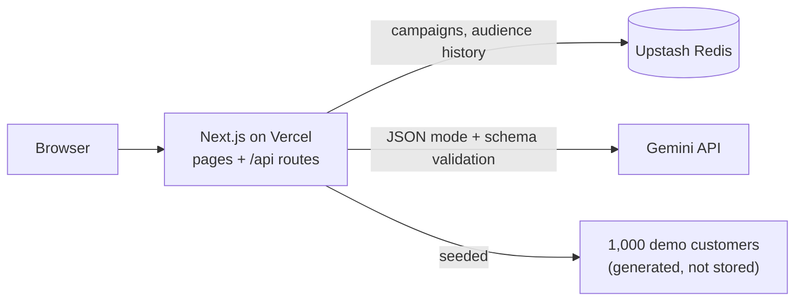

# AI Campaign Copilot

A marketing CRM where you describe an audience in plain English, get AI-written campaign copy and a channel recommendation, send it, and watch results fill in live. One Next.js app, deployed to Vercel with a single click.

> "Find customers who spent over INR 5000 and have not purchased in 60 days"
> → filters `{ minSpend: 5000, inactiveDays: 60 }` → matching customers → WhatsApp win-back copy → hold to send → live results.

## Features

- **Natural-language segmentation.** Gemini turns a sentence into typed audience filters. A rule-based parser takes over when no key is set or the model returns something invalid.
- **AI copywriting and channel choice.** The model drafts the title, subject, body and button (with `{{name}}` personalisation) and recommends WhatsApp, SMS, Email or RCS with a reason.
- **Simulated delivery, no background jobs.** Each recipient's delivered, opened, clicked and bought times are derived from a hash of the campaign and customer IDs, so results "arrive" as time passes and every server computes the same answer.
- **Live results.** Activity rings, a funnel that counts every stage a message reached, a feed of customer responses, and AI suggestions on what to try next.
- **Live message preview.** See the message as the customer will on each channel, with their name filled in and SMS length counted.
- **Installable on phones.** Add it to the Home Screen on iPhone or Android (PWA).

## Design

- **Palette:** Hostinger colour scheme #29 (indigo `#1D1842`, wine `#8E0D3C`, red-orange `#EF3B33`, pink `#FDA1A2`). The red-orange is deepened to `#D7261E` in light mode and brightened to coral `#FF6B5E` in dark mode so text and buttons pass WCAG AA.
- **Apple Human Interface Guidelines:** system typeface and text styles, inset grouped forms, pill buttons, a segmented control for channels, 44 pt touch targets, safe areas, and light and dark appearance.
- **Structure:** the app opens on a dashboard (people reached, open and purchase rates, recent campaigns, latest results, top customers). New campaigns are created in a full-screen four-step wizard (audience, message, channel, review). A floating menu button in the bottom-right corner switches sections.
- **3D:** the landing page hero is a three.js phone (React Three Fiber + drei) whose screen is drawn to a canvas texture; it tilts with the pointer, holds still when reduced motion is on, and falls back to a flat phone without WebGL.
- **Components:** the Hold to send button and the result rings are adapted from [Kokonut UI](https://kokonutui.com) (MIT); animation uses [Motion](https://motion.dev).
- **Pages:** `/` is the landing page and `/app` is the product.

## Architecture



| Path | What it does |
| --- | --- |
| `app/page.tsx` | Landing page with the 3D phone |
| `app/app/page.tsx` | The product: dashboard, campaigns, customers, new-campaign wizard |
| `app/api/**/route.ts` | API routes: audience preview, AI copy and channel, campaigns, launch, insights |
| `lib/server/customers.ts` | Deterministic demo customers and audience matching |
| `lib/server/simulate.ts` | Time-based delivery simulation |
| `lib/server/db.ts` | Campaign storage (Upstash Redis, in-memory when running locally without it) |
| `lib/server/ai.ts` | Gemini calls with schema-checked output and rule-based fallbacks |

**Why this shape:** the earlier version ran three services (web, CRM API, channel service) on two hosts, connected by API keys and signed webhooks. Generating demo customers from a fixed seed and computing delivery results from time removed the need for a separate backend, a message queue and a database for customers, so the whole product now deploys as one Vercel project.

## Safety

- **Every API input is validated** with Zod, including length limits on prompts and message text.
- **Model output is untrusted:** Gemini runs in JSON mode, every response is checked against a schema, and user text is passed to the model as quoted data.
- **Launching is idempotent:** sending the same campaign twice is a no-op.
- **Errors are mapped:** bad input returns 400, missing records 404, and anything else a generic 500 with no internal details.

## Getting started

Requires Node 22+.

```bash
npm install
npm run dev
```

Open http://localhost:3000. Without any environment variables the app runs fully: AI features use rule-based answers and campaigns are kept in memory until the dev server restarts. Copy `.env.example` to `.env` to add a Gemini key or a Redis database.

| Variable | Purpose |
| --- | --- |
| `GEMINI_API_KEY`, `GEMINI_MODEL` | Turn on Gemini (default model `gemini-2.5-flash`) |
| `KV_REST_API_URL`, `KV_REST_API_TOKEN` | Upstash Redis for campaigns (set automatically on Vercel) |

## Scripts

| Command | What it does |
| --- | --- |
| `npm run dev` | Run the app with hot reload |
| `npm test` | Unit tests (`node:test` through `tsx`) |
| `npm run typecheck` | Strict TypeScript |
| `npm run build` | Production build |

CI runs typecheck, tests and build on every push and pull request.

## Deployment (Vercel)

1. Import the repo on Vercel and set **Root Directory** to `apps/web`.
2. In the project's **Storage** tab, add **Upstash for Redis** and connect it to the project. Its keys are added automatically.
3. Optionally add `GEMINI_API_KEY` under **Settings → Environment Variables**.
4. Redeploy. `/api/health` reports `"database": "redis"` when storage is connected.

## Design decisions and trade-offs

- **Generated customers instead of a customer table.** Fast, free and identical on every server. A real CRM would import customers into Postgres.
- **Time-based simulation instead of a message queue.** No workers or webhooks to run. Real provider callbacks would need a queue and idempotent event handling.
- **Polling instead of WebSockets.** The dashboard refreshes every few seconds; server-sent events would be the next step.

## Roadmap

- [ ] Real customer import (CSV) into Postgres
- [ ] Real messaging providers behind a queue, with retries
- [ ] User accounts and per-workspace data
- [ ] Consent, opt-out and frequency capping
- [ ] End-to-end tests (Playwright)
